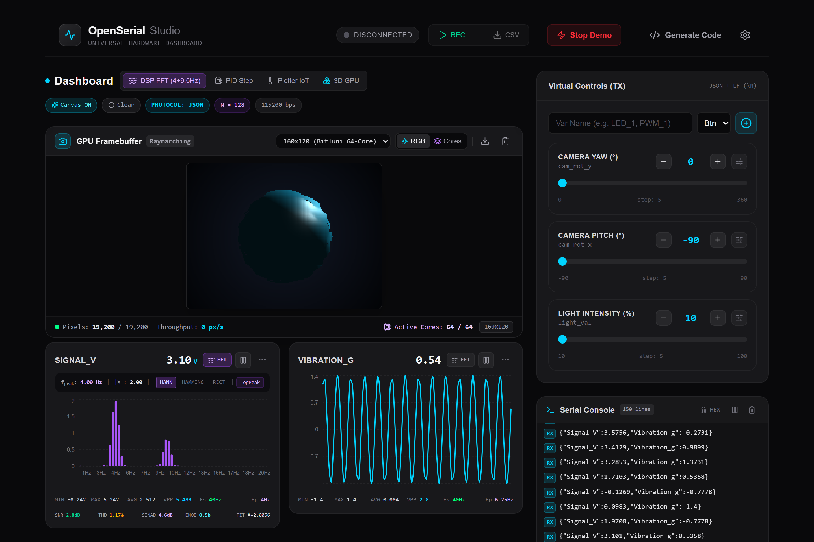
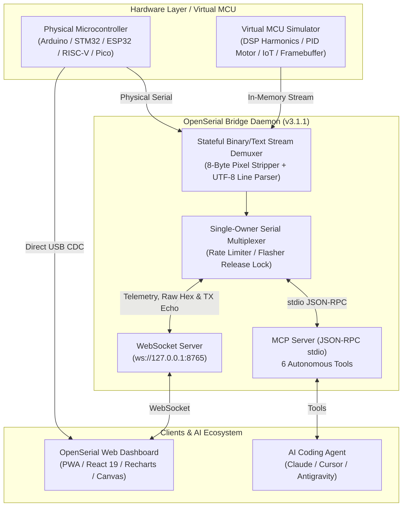

<div align="center">
  
  <br/>
  <h1>OpenSerial Studio</h1>
  <h3>Universal Web Serial Telemetry Dashboard, MCP Hardware Bridge & Laboratory DSP Metrology Engine</h3>
  <p>Seamlessly visualize, control, and analyze real-time telemetry and binary streams from any microcontroller directly in your browser.</p>

  <p>
    <a href="https://react.dev/"></a>
    <a href="https://vitejs.dev/"></a>
    <a href="https://tailwindcss.com/"></a>
    <a href="https://github.com/ptai-eng/OpenSerial-Studio/releases"></a>
    <a href="https://modelcontextprotocol.io/"></a>
    <a href="https://developer.mozilla.org/en-US/docs/Web/Progressive_web_apps"></a>
    <a href="https://opensource.org/licenses/MIT"></a>
  </p>

  
</div>

---

## 📖 Introduction

**OpenSerial Studio** is a platform-agnostic telemetry dashboard, binary framebuffer visualizer, and signal metrology workstation built for electronics & telecommunications engineers, embedded firmware developers, and robotics researchers. It features a **Hybrid Dual-Transport Architecture**:

1. **Zero-Install Web Serial Mode:** Connects directly from modern browsers (Chrome, Edge, Opera) to hardware COM ports via the native Web Serial API without requiring local installations or custom drivers.
2. **Local Bridge Daemon & MCP Server Mode (`v3.0+`):** Runs a lightweight local daemon multiplexing physical serial ports or closed-loop virtual simulators (`dsp_harmonics`, `pid_motor`, `iot_env`, `raymarcher_gpu`) to both the Web Dashboard (`ws://127.0.0.1:8765`) and AI Coding Assistants (Claude, Cursor, Antigravity) via the official **Model Context Protocol (MCP)**.
3. **2D/3D Canvas Framebuffer & Binary Stream Demuxing (`v3.1+`):** Ingests compact 8-byte binary pixel packets (`[0xAA, 0x55, ...]`) alongside standard JSON/CSV telemetry, rendering real-time camera feeds, thermal arrays, or custom hardware graphics with optional worker-node heatmap overlays.



---

## ✨ Core Engineering Capabilities

### 1. Multi-Protocol Zero-Config Telemetry Parser
- **JSON Telemetry:** Parses flat and nested JSON streams (`{"Temp": 25.4, "Vbat": 3.82, "IMU": {"roll": 1.2}}`) with automatic unit inference and explicit `{value, unit}` unwrapping.
- **Serial Plotter Format:** Parses key-value pairs (`Temp:25.4,Humid:60,Status:READY`) and whitespace/tab-delimited streams with zero configuration.
- **Raw CSV / TSV Streams:** Automatically routes multi-column numeric streams (`25.4, 60.2, 1023`) into channels `CH1`..`CHn`.
- **True Binary HEX Sniffer & Transmitter (`tx_raw_hex`):** Inspects and transmits raw `Uint8Array` byte packets (preserving bytes `>= 0x80` across both Web Serial and Bridge WebSocket without UTF-8 replacement character corruption) for debugging binary protocols and Modbus RTU.

### 2. Hardware Timebase & USB CDC Jitter Elimination
- **The Physical Problem:** Operating system USB CDC host controllers poll bulk transfer endpoints in non-deterministic intervals (1 ms to 16 ms frames). Relying on browser arrival clocks causes artificial timing jitter when streaming at rates above 100 Hz.
- **Hardware-Locked Timebase:** Automatically detects hardware timestamp fields (`t_us`, `time_us`, `t_ms`, `micros`, `millis`, `seq`, `n`) directly from microcontroller hardware timers.
- **Widget Suppression:** Automatically extracts and strips hardware timebase keys from the widget pipeline, preventing monotonically increasing timer counts from cluttering the dashboard.
- **32-Bit Microsecond Wrap-Around Handling:** Smoothly handles hardware timer roll-overs (such as `micros()` wrapping at $2^{32} \approx 4294.9\text{ s}$).

### 3. Laboratory DSP & Numerical Methods Engine
- **In-Place Radix-2 Cooley-Tukey FFT:** $O(N \log_2 N)$ complex bit-reversal and butterfly factorization over power-of-two window sizes $N \in \{64, 128, 256, 512, 1024\}$.
- **Leakage Suppression Windowing:**
  - **Hann Window:** $w[n] = 0.5 \left(1 - \cos\frac{2\pi n}{N-1}\right)$ (sidelobe attenuation $-31.5\text{ dB}$).
  - **Hamming Window:** $w[n] = 0.54 - 0.46 \cos\frac{2\pi n}{N-1}$ (sidelobe attenuation $-42.7\text{ dB}$).
  - **Rectangular:** Uniform Dirichlet kernel for transient capture.
- **Sub-Bin Spectral Peak Interpolation:**
  - **Gaussian Log-Parabolic Fit:** Asymptotically unbiased peak frequency and amplitude estimation on $\ln|X[k]|$.
  - **Lagrange Linear Parabolic Fit:** Classical 3-point polynomial interpolation on $|X[k]|$.
- **IEEE-1241 Spectral Distortion Metrology:**
  - **SNR (Signal-to-Noise Ratio):** $10 \log_{10}(P_{\text{fund}} / P_{\text{noise}})$
  - **THD (Total Harmonic Distortion):** $10 \log_{10}(P_{\text{harm}} / P_{\text{fund}})$ up to the 5th harmonic.
  - **SINAD & ENOB:** $\text{ENOB} = (\text{SINAD}_{\text{dB}} - 1.76) / 6.02$
- **IEEE-1057 3-Parameter Sine Fit:** Linear least-squares analytical solution of $y(t) = A_0 \cos(\omega_0 t) + B_0 \sin(\omega_0 t) + C_0$ via Cramer's rule on the normal equations matrix.
- **Welch Power Spectral Density (PSD):** 50% overlapping Hann periodogram averaging for stationary noise characterization.

### 4. Binary Canvas Framebuffer & Stateful Stream Demuxer
- **8-Byte Bit-Packed Pixel Protocol:** Supports resolutions up to $512 \times 512$ (`160x120`, `80x60`, `320x240` presets) in a compact 8-byte frame:
  - `Byte 0..1`: Magic Header `[0xAA, 0x55]`
  - `Byte 2`: `X & 0xFF` (Low 8 bits of $X$)
  - `Byte 3`: `Y & 0xFF` (Low 8 bits of $Y$)
  - `Byte 4..6`: `R`, `G`, `B` ($0..255$ color channels)
  - `Byte 7`: `(nodeId & 0x3F) | (((X >> 8) & 0x01) << 6) | (((Y >> 8) & 0x01) << 7)` — packs 6-bit source/node ID ($0..63$) together with the 9th bit of $X$ and $Y$.
- **Stateful USB Bulk Transfer Demuxer (`StatefulBinaryDemuxer`):** Reassembles 8-byte pixel packets split across 64-byte USB CDC transfer boundaries and strips binary pixels out before UTF-8 line decoding, ensuring coordinate or color bytes equal to `0x0A` (`10`) never trigger false newline breaks in the text parser.
- **1-Click PNG Snapshot:** Exports the live hardware framebuffer directly to a timestamped `.png` image.

### 5. 4-Platform Firmware Code Generator
Instantly generates memory-safe, production-ready embedded firmware templates:
- **Arduino C++ / ESP32 (ArduinoJson v7):** Zero dynamic heap allocations using a static `char rxBuffer[256]` line reader, hardware PWM timer pin routing (`D3, D5, D6, D9, D10, D11`), and inline `sendPixel512()` helper.
- **Zero-Library Arduino Serial Plotter:** Ultra-lightweight firmware without third-party dependencies.
- **STM32 HAL C (Idle Line DMA):** `HAL_UARTEx_ReceiveToIdle_DMA` circular reception with atomic IRQ protection (`__disable_irq()` / `__enable_irq()`), half-transfer interrupt suppression, and `-u _printf_float` linker guidance.
- **MicroPython (ESP32 & RP2040 Pico):** Non-blocking `select.poll` event loop with `duty_u16` PWM control and ADC1 pin routing (`GPIO 32..39`) to prevent driver panics when Wi-Fi is active.

### 6. Local Bridge Daemon & MCP Server Ecosystem
- **Single-Owner Serial Multiplexer:** Solves the physical single-owner constraint of UART hardware. Web dashboards and AI assistants read and write simultaneously through a local WebSocket server (`ws://127.0.0.1:8765`), complete with a **Header Target Port Selector** and **1-Click Flash Unlock (`released_for_flash`)** button.
- **Closed-Loop Virtual MCU Simulator:** Provides 4 real-time hardware simulation channels (`sim://dsp_harmonics`, `sim://pid_motor`, `sim://iot_env`, `sim://raymarcher_gpu`) responding dynamically to incoming commands.
- **Standard Model Context Protocol (MCP) Tools:**
  - `serial_list_ports`: Enumerates available COM ports and virtual simulation channels.
  - `serial_connect`: Connects to hardware or virtual simulator.
  - `serial_release_port`: Temporarily releases port lock for external CLI flashers (`arduino-cli`, `esptool`, `stm32cubeprog`) without "Port busy" errors.
  - `serial_read_telemetry`: Progressive token detail (`summary` vs `complete`), coverage tracking, and `_meta.provenance.untrusted_content = true` defense against indirect prompt injection.
  - `serial_send_command`: Injects command to hardware and broadcasts purple `[MCP TX]` badge on connected dashboards.
  - `serial_generate_firmware`: Generates target-specific embedded firmware.

#### Quickstart OpenSerial Bridge Daemon:
```bash
# Start bridge with virtual PID motor simulator
npx tsx bridge/cli.ts --sim pid_motor
# or using Node v24+ native TypeScript runner:
npm run bridge -- --sim dsp_harmonics

# Start bridge with physical hardware COM port
npm run bridge -- --port COM3 --baud 115200

# Configure in Claude Desktop or Cursor (claude_desktop_config.json):
{
  "mcpServers": {
    "openserial": {
      "command": "node",
      "args": ["/path/to/OpenSerial-Studio/bridge/cli.ts", "--sim", "dsp_harmonics"]
    }
  }
}
```

---

## 🔬 Mathematical Foundations of the DSP Engine

### 1. Radix-2 Cooley-Tukey Discrete Fourier Transform

For a finite discrete time sequence $x[n]$ of length $N = 2^m$:

$$
X[k] = \sum_{n=0}^{N-1} x[n] W_N^{kn}, \quad W_N = e^{-j \frac{2\pi}{N}}
$$

The Cooley-Tukey algorithm decomposes the $N$-point sum into two $(N/2)$-point transforms over even and odd indexed samples:

$$
X[k] = E[k] + W_N^k O[k], \quad X[k + N/2] = E[k] - W_N^k O[k]
$$

Coherent amplitude scaling for the single-sided spectrum ($k = 1 \dots \frac{N}{2}-1$):

$$
|X_{\text{scaled}}[k]| = \frac{2 \cdot |X[k]|}{N \cdot G_{\text{coh}}}, \quad G_{\text{coh}} = \frac{1}{N}\sum_{n=0}^{N-1} w[n]
$$

### 2. Sub-Bin Peak Frequency Interpolation

Because the discrete FFT evaluates frequencies only at integer bin multiples $\Delta f = f_s / N$, real-world peaks frequently fall between bins $k^*$ and $k^* \pm 1$.

```text
Magnitude |X(k)|
    ^
    |          beta (Peak Bin k*)
    |           /\
    |   alpha  /  \  gamma
    |    (k*-1)    \ (k*+1)
    +------------------------> Frequency Bin k
              <delta>
```

#### Gaussian Log-Parabolic Interpolation (`gaussian_log`):
For bell-shaped window kernels (Hann, Gaussian), the log-magnitude spectrum forms a parabola:

$$
\delta_{\text{log}} = \frac{1}{2}\frac{\ln(\alpha) - \ln(\gamma)}{\ln(\alpha) - 2\ln(\beta) + \ln(\gamma)}
$$

$$
f_{\text{peak}} = (k^* + \delta_{\text{log}}) \frac{f_s}{N}, \quad A_{\text{peak}} = \exp\left(\ln(\beta) - \frac{1}{4}(\ln(\alpha) - \ln(\gamma))\delta_{\text{log}}\right)
$$

#### Lagrange Linear Interpolation (`lagrange_linear`):
Classical quadratic interpolation directly on linear amplitude:

$$
\delta_{\text{lin}} = \frac{1}{2}\frac{\alpha - \gamma}{\alpha - 2\beta + \gamma}, \quad f_{\text{peak}} = (k^* + \delta_{\text{lin}}) \frac{f_s}{N}
$$

### 3. IEEE-1057 Linear Least-Squares Sine Fit

Given $N$ samples $y_n$ acquired at sampling interval $T = 1 / f_s$ with estimated angular frequency $\omega_0 = 2\pi f_0$, the three-parameter model equation is:

$$
y_n = A_0 \cos(\omega_0 t_n) + B_0 \sin(\omega_0 t_n) + C_0
$$

Defining $c_n = \cos(\omega_0 t_n)$ and $s_n = \sin(\omega_0 t_n)$, the normal equations $M \cdot \theta = V$ for parameter vector $\theta = [A_0, B_0, C_0]^T$ are solved analytically via Cramer's Rule:

$$
M = \begin{pmatrix} \sum c_n^2 & \sum c_n s_n & \sum c_n \\ \sum c_n s_n & \sum s_n^2 & \sum s_n \\ \sum c_n & \sum s_n & N \end{pmatrix}, \quad \theta = \begin{pmatrix} A_0 \\ B_0 \\ C_0 \end{pmatrix}, \quad V = \begin{pmatrix} \sum y_n c_n \\ \sum y_n s_n \\ \sum y_n \end{pmatrix}
$$

From the solved parameter vector $\theta = M^{-1} V$:

$$
\text{Amplitude} = \sqrt{A_0^2 + B_0^2}, \quad \text{Phase} = \text{atan2}(-B_0, A_0), \quad \text{Offset} = C_0
$$

$$
\text{RMSE} = \sqrt{\frac{1}{N}\sum_{n=0}^{N-1} \left(y_n - [A_0 \cos(\omega_0 t_n) + B_0 \sin(\omega_0 t_n) + C_0]\right)^2}
$$

---

## 🚀 Quick Start Guide

### System Requirements
- Node.js (v20+ or v24+)
- A Chromium-based browser (Google Chrome, Microsoft Edge, Opera, Brave) supporting the **Web Serial API** (or any modern browser when using **Bridge WS** mode).

### Installation & Local Run

```bash
# 1. Clone repository
git clone https://github.com/ptai-eng/OpenSerial-Studio.git
cd OpenSerial-Studio

# 2. Install dependencies
npm install

# 3. Launch Vite development server
npm run dev

# 4. Execute full verification test suite (64 tests across 20 suites)
npm test
```

---

## 🔌 Hardware Telemetry Code Examples

### 1. Arduino / ESP32 (Zero-Jitter Hardware Timebase + Optional Framebuffer)

```cpp
#include <Arduino.h>
#include <ArduinoJson.h>

// Optional helper for streaming 8-byte binary pixels to the Canvas widget (up to 512x512)
static inline void sendPixel512(uint16_t x, uint16_t y, uint8_t r, uint8_t g, uint8_t b, uint8_t nodeId = 0) {
  uint8_t pkt[8] = {
    0xAA, 0x55,
    (uint8_t)(x & 0xFF), (uint8_t)(y & 0xFF),
    r, g, b,
    (uint8_t)((nodeId & 0x3F) | (((x >> 8) & 0x01) << 6) | (((y >> 8) & 0x01) << 7))
  };
  Serial.write(pkt, 8);
}

void setup() {
  Serial.begin(115200);
}

void loop() {
  // Transmit JSON telemetry at 100 Hz (10 ms interval)
  static unsigned long lastSend = 0;
  if (micros() - lastSend >= 10000) {
    lastSend = micros();

    JsonDocument doc;
    doc["t_us"] = micros(); // Microsecond timebase eliminates USB CDC latency jitter
    doc["Voltage_V"] = analogRead(A0) * (5.0 / 1023.0);
    doc["Current_mA"] = analogRead(A1) * (500.0 / 1023.0);

    serializeJson(doc, Serial);
    Serial.println();
  }
}
```

### 2. MicroPython (ESP32 / Raspberry Pi Pico)

```python
import machine, time, json, sys

adc = machine.ADC(machine.Pin(34)) # Safe ESP32 ADC1 pin
last_tick = time.ticks_us()

while True:
    now = time.ticks_us()
    if time.ticks_diff(now, last_tick) >= 10000: # 100 Hz
        last_tick = now
        payload = {
            "t_us": now,
            "Signal_V": round(adc.read_u16() * 3.3 / 65535, 3)
        }
        sys.stdout.write(json.dumps(payload) + "\n")
```

---

## 🛡️ Verification & Test Suite

OpenSerial Studio enforces strict behavioral verification with zero test skipping:

```bash
$ npm test

▶ OpenSerial Studio v2.0 — Multi-Protocol Telemetry Parser (5/5 PASS)
▶ OpenSerial Studio v2.0 — 4-Platform Firmware Code Generator (4/4 PASS)
▶ OpenSerial Studio v2.1.1 — Hardware Bugfixes & Timing Metrology (10/10 PASS)
▶ OpenSerial Studio v2.1 — DSP & Numerical Methods (Radix-2 FFT) (4/4 PASS)
▶ OpenSerial Studio v2.3 — Hardware Timebase & USB CDC Jitter Elimination (4/4 PASS)
▶ OpenSerial Studio v2.3 — Deep DSP & Numerical Methods (4/4 PASS)
▶ OpenSerial Studio v3.0 — Virtual MCU Simulator (Closed-Loop Physics) (3/3 PASS)
▶ OpenSerial Studio v3.0 — Serial Multiplexer & WebSocket Broadcast (3/3 PASS)
▶ OpenSerial Studio v3.0 — MCP Server Tool Contract (rea-tool-design) (6/6 PASS)
▶ OpenSerial Studio v3.1 — Framebuffer Pixel Protocol & Ingestion (3/3 PASS)
▶ OpenSerial Studio v3.1 — Core Heatmap Palette (3/3 PASS)
▶ OpenSerial Studio v3.1 — 3D Raymarching Algorithm (2/2 PASS)
▶ OpenSerial Studio v3.1 — Closed-Loop Framebuffer Simulator (2/2 PASS)
▶ OpenSerial Studio v3.1 — Bridge Multiplexer & v3.1.1 Hardening Suite (5/5 PASS)
▶ OpenSerial Studio — Workspace Persistence & Profile Serialization (4/4 PASS)

✔ All 64 tests passing across 20 suites (0 warnings, 0 errors)
```

---

## 📄 License

This project is licensed under the **MIT License**. Created by [**Phát Tài (ptai-eng)**](https://github.com/ptai-eng).
