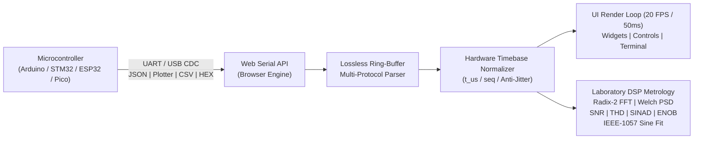

<div align="center">
  
  <br/>
  <h1>OpenSerial Studio</h1>
  <h3>Universal, Zero-Config Web Serial Dashboard & Laboratory DSP Metrology Engine</h3>
  <p>Seamlessly visualize, control, and analyze telemetry from ANY microcontroller in real-time right from your browser.</p>

  <p>
    <a href="https://react.dev/"></a>
    <a href="https://vitejs.dev/"></a>
    <a href="https://tailwindcss.com/"></a>
    <a href="https://github.com/ptai-eng/OpenSerial-Studio/releases"></a>
    <a href="https://developer.mozilla.org/en-US/docs/Web/Progressive_web_apps"></a>
    <a href="https://opensource.org/licenses/MIT"></a>
  </p>

  
</div>

---

## 📖 Introduction

**OpenSerial Studio** is an industrial-grade, platform-agnostic web telemetry dashboard and signal metrology workstation built for electronics & telecommunications engineers, embedded firmware developers, and robotics researchers. Leveraging the modern **Web Serial API**, it establishes direct bidirectional UART/USB CDC links with hardware without requiring local daemon installations, bridge drivers, or native compilers.

The architectural philosophy of OpenSerial Studio centers on **Hardware Independence and Scientific Precision**. Whether you are interfacing an 8-bit AVR Arduino, an ESP32 dual-core SoC, an STM32 ARM Cortex-M with DMA, a Raspberry Pi Pico (RP2040/RP2350), or a custom FPGA soft-core, OpenSerial Studio automatically ingests, parses, renders, and analyzes your telemetry in real-time.



---

## ✨ Core Engineering Capabilities

### 1. Multi-Protocol Zero-Config Telemetry Parser
- **JSON Telemetry:** Parses flat and nested JSON streams (`{"Temp": 25.4, "Vbat": 3.82, "IMU": {"roll": 1.2}}`) with automatic unit inference and explicit `{value, unit}` unwrapping.
- **Serial Plotter Format:** Parses key-value pairs (`Temp:25.4,Humid:60,Status:READY`) and whitespace/tab-delimited streams with zero configuration.
- **Raw CSV / TSV Streams:** Automatically routes multi-column numeric streams (`25.4, 60.2, 1023`) into channels `CH1`..`CHn`.
- **True Binary HEX Sniffer:** Inspects raw `Uint8Array` byte packets (preserving bytes $\ge \text{0x80}$ without UTF-8 replacement character corruption) for debugging binary frames and Modbus RTU.

### 2. Hardware Timebase & USB CDC Jitter Elimination
- **The Physical Problem:** Operating system USB CDC host controllers poll bulk transfer endpoints in non-deterministic intervals (1 ms to 16 ms frames). Relying on browser arrival clocks causes severe artificial timing jitter when streaming at rates $> 100\text{ Hz}$.
- **Hardware-Locked Timebase:** Automatically detects hardware timestamp fields (`t_us`, `time_us`, `t_ms`, `micros`, `millis`, `seq`, `n`) directly from microcontroller hardware timers.
- **Widget Suppression:** Automatically extracts and strips hardware timebase keys from the widget pipeline, preventing noisy, climbing time graphs from cluttering the dashboard.
- **32-Bit Microsecond Wrap-Around Handling:** Smoothly handles hardware timer roll-overs (such as `micros()` wrapping at $2^{32} \approx 4294.9\text{ seconds}$).

### 3. Laboratory DSP & Numerical Methods Engine
- **In-Place Radix-2 Cooley-Tukey FFT:** $O(N \log_2 N)$ complex bit-reversal and butterfly factorization over power-of-two window sizes $N \in \{64, 128, 256, 512, 1024\}$.
- **Leakage Suppression Windowing:**
  - **Hann Window:** $\displaystyle w[n] = 0.5 \left(1 - \cos\frac{2\pi n}{N-1}\right)$ (sidelobe attenuation $-31.5\text{ dB}$).
  - **Hamming Window:** $\displaystyle w[n] = 0.54 - 0.46 \cos\frac{2\pi n}{N-1}$ (sidelobe attenuation $-42.7\text{ dB}$).
  - **Rectangular:** Uniform Dirichlet kernel for transient capture.
- **Sub-Bin Spectral Peak Interpolation:**
  - **Gaussian Log-Parabolic Fit:** Asymptotically unbiased peak frequency and amplitude estimation on $\ln|X(k)|$.
  - **Lagrange Linear Parabolic Fit:** Classical 3-point polynomial interpolation on $|X(k)|$.
- **IEEE-1241 Spectral Distortion Metrology:**
  - **SNR (Signal-to-Noise Ratio):** $\displaystyle \text{SNR} = 10 \log_{10}\left(\frac{P_{\text{fund}}}{P_{\text{noise}}}\right)$
  - **THD (Total Harmonic Distortion):** $\displaystyle \text{THD} = 10 \log_{10}\left(\frac{P_{\text{harm}}}{P_{\text{fund}}}\right)$ up to the 5th harmonic.
  - **SINAD & ENOB:** $\displaystyle \text{SINAD} = 10 \log_{10}\left(\frac{P_{\text{fund}} + P_{\text{harm}} + P_{\text{noise}}}{P_{\text{harm}} + P_{\text{noise}}}\right)$, $\displaystyle \text{ENOB} = \frac{\text{SINAD}_{\text{dB}} - 1.76}{6.02}$
- **IEEE-1057 3-Parameter Sine Fit:** Linear least-squares analytical solution of $y(t) = A \cos(\omega_0 t) + B \sin(\omega_0 t) + C$ via Cramer's rule on normal equations matrix.
- **Welch Power Spectral Density (PSD):** 50% overlapping Hann periodogram averaging for stationary noise characterization.

### 4. 4-Platform Firmware Code Generator
Instantly generates memory-safe, production-ready embedded firmware templates:
- **Arduino C++ (ArduinoJson v7):** Zero dynamic heap allocations using a static `char rxBuffer[256]` line reader, with hardware PWM timer pin routing (`D3, D5, D6, D9, D10, D11`).
- **Zero-Library Arduino Serial Plotter:** Ultra-lightweight firmware without third-party dependencies.
- **STM32 HAL C (Idle Line DMA):** `HAL_UARTEx_ReceiveToIdle_DMA` circular reception with atomic IRQ protection (`__disable_irq()` / `__enable_irq()`), half-transfer interrupt suppression, and `-u _printf_float` linker guidance.
- **MicroPython (ESP32 & RP2040 Pico):** Non-blocking `select.poll` event loop with `duty_u16` PWM control and ADC1 pin routing (`GPIO 32..39`) to prevent driver panics when Wi-Fi is active.

### 5. Workspace Persistence & Profile Sharing
- **Local Synchronization:** Preserves baud rate, FFT window size $N$, slider boundaries, and widget modes automatically in browser storage.
- **Profile Export/Import:** Export and import complete hardware workspaces as portable `.json` files.

---

## 🔬 Mathematical Foundations of the DSP Engine

### 1. Radix-2 Cooley-Tukey Discrete Fourier Transform

For a finite discrete time sequence $x[n]$ of length $N = 2^m$:

$$X[k] = \sum_{n=0}^{N-1} x[n] W_N^{kn}, \quad W_N = e^{-j \frac{2\pi}{N}}$$

The Cooley-Tukey algorithm decomposes the $N$-point sum into two $\frac{N}{2}$-point transforms over even and odd indexed samples:

$$X[k] = E[k] + W_N^k O[k], \quad X\left[k + \frac{N}{2}\right] = E[k] - W_N^k O[k]$$

Coherent amplitude scaling for single-sided spectrum ($k = 1 \dots \frac{N}{2}-1$):

$$|X_{\text{scaled}}[k]| = \frac{2 \cdot |X[k]|}{N \cdot G_{\text{coh}}}, \quad G_{\text{coh}} = \frac{1}{N}\sum_{n=0}^{N-1} w[n]$$

### 2. Sub-Bin Peak Frequency Interpolation

Because the discrete FFT evaluates frequencies only at integer bin multiples $\Delta f = f_s / N$, real-world peaks frequently fall between bins $k^*$ and $k^* \pm 1$.

```
Magnitude |X(k)|
    ^
    |          beta (Peak Bin k*)
    |           /\
    |   alpha  /  \  gamma
    |    (k*-1)    \ (k*+1)
    +------------------------> Frequency Bin k
              <delta>
```

#### Gaussian Log-Parabolic Interpolation (`gaussian_log`):
For bell-shaped window kernels (Hann, Gaussian), the log-magnitude spectrum forms an exact parabola:

$$\delta_{\text{log}} = \frac{1}{2}\frac{\ln(\alpha) - \ln(\gamma)}{\ln(\alpha) - 2\ln(\beta) + \ln(\gamma)}$$

$$f_{\text{peak}} = (k^* + \delta_{\text{log}}) \frac{f_s}{N}, \quad A_{\text{peak}} = \exp\left(\ln(\beta) - \frac{1}{4}(\ln(\alpha) - \ln(\gamma))\delta_{\text{log}}\right)$$

#### Lagrange Linear Interpolation (`lagrange_linear`):
Classical quadratic interpolation directly on linear amplitude:

$$\delta_{\text{lin}} = \frac{1}{2}\frac{\alpha - \gamma}{\alpha - 2\beta + \gamma}, \quad f_{\text{peak}} = (k^* + \delta_{\text{lin}}) \frac{f_s}{N}$$

### 3. IEEE-1057 Linear Least-Squares Sine Fit

Given $N$ samples $y_n$ acquired at sampling interval $T = 1 / f_s$ with estimated angular frequency $\omega_0 = 2\pi f_0$, the model equation is:

$$y_n = A_0 \cos(\omega_0 t_n) + B_0 \sin(\omega_0 t_n) + C_0$$

The normal equations matrix $M \cdot [A_0, B_0, C_0]^T = V$ is solved via Cramer's Rule:

$$\begin{bmatrix}
\sum \cos^2(\omega_0 t_n) & \sum \cos(\omega_0 t_n)\sin(\omega_0 t_n) & \sum \cos(\omega_0 t_n) \\
\sum \cos(\omega_0 t_n)\sin(\omega_0 t_n) & \sum \sin^2(\omega_0 t_n) & \sum \sin(\omega_0 t_n) \\
\sum \cos(\omega_0 t_n) & \sum \sin(\omega_0 t_n) & N
\end{bmatrix}
\begin{bmatrix} A_0 \\ B_0 \\ C_0 \end{bmatrix}
=
\begin{bmatrix} \sum y_n \cos(\omega_0 t_n) \\ \sum y_n \sin(\omega_0 t_n) \\ \sum y_n \end{bmatrix}$$

From the parameter vector:

$$\text{Amplitude} = \sqrt{A_0^2 + B_0^2}, \quad \text{Phase} = \text{atan2}(-B_0, A_0), \quad \text{Offset} = C_0$$

$$\text{RMSE} = \sqrt{\frac{1}{N}\sum_{n=0}^{N-1} \left(y_n - [A_0 \cos(\omega_0 t_n) + B_0 \sin(\omega_0 t_n) + C_0]\right)^2}$$

---

## 🚀 Quick Start Guide

### System Requirements
- Node.js (v18+ or v20+)
- A Chromium-based browser (Google Chrome, Microsoft Edge, Opera, Brave) supporting the **Web Serial API**.

### Installation & Local Run

```bash
# 1. Clone repository
git clone https://github.com/ptai-eng/OpenSerial-Studio.git
cd OpenSerial-Studio

# 2. Install dependencies
npm install

# 3. Launch Vite development server
npm run dev

# 4. Execute test suite
npm test
```

---

## 🔌 Hardware Telemetry Code Examples

### 1. Arduino / ESP32 (Zero-Jitter Hardware Timebase)

```cpp
#include <Arduino.h>
#include <ArduinoJson.h>

void setup() {
  Serial.begin(115200);
}

void loop() {
  // Transmit at 100 Hz (10 ms interval)
  static unsigned long lastSend = 0;
  if (micros() - lastSend >= 10000) {
    lastSend = micros();

    JsonDocument doc;
    doc["t_us"] = micros(); // Microsecond timebase eliminates USB CDC latency jitter
    doc["Voltage_V"] = analogRead(A0) * (5.0 / 1023.0);
    doc["Current_mA"] = analogRead(A1) * (500.0 / 1023.0);

    serializeJson(doc, Serial);
    Serial.println();
  }
}
```

### 2. MicroPython (ESP32 / Raspberry Pi Pico)

```python
import machine, time, json, sys

adc = machine.ADC(machine.Pin(34)) # Safe ESP32 ADC1 pin
last_tick = time.ticks_us()

while True:
    now = time.ticks_us()
    if time.ticks_diff(now, last_tick) >= 10000: # 100 Hz
        last_tick = now
        payload = {
            "t_us": now,
            "Signal_V": round(adc.read_u16() * 3.3 / 65535, 3)
        }
        sys.stdout.write(json.dumps(payload) + "\n")
```

---

## 🛡️ Verification & Test Suite

OpenSerial Studio enforces strict behavioral verification with zero test skipping:

```bash
$ npm test

▶ OpenSerial Studio v2.0 — Multi-Protocol Telemetry Parser (5/5 PASS)
▶ OpenSerial Studio v2.0 — 4-Platform Firmware Code Generator (4/4 PASS)
▶ OpenSerial Studio v2.1.1 — Hardware Bugfixes & Timing Metrology (10/10 PASS)
▶ OpenSerial Studio v2.1 — DSP & Numerical Methods (Radix-2 FFT) (4/4 PASS)
▶ OpenSerial Studio v2.3 — Hardware Timebase & USB CDC Jitter Elimination (4/4 PASS)
▶ OpenSerial Studio v2.3 — Deep DSP & Numerical Methods (4/4 PASS)
▶ OpenSerial Studio — Workspace Persistence & Profile Serialization (4/4 PASS)

✔ All 37 tests passing (0 warnings, 0 errors)
```

---

## 📄 License

This project is licensed under the **MIT License**. Created by [**Phát Tài (ptai-eng)**](https://github.com/ptai-eng).
